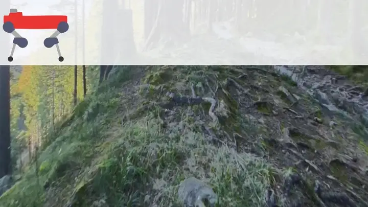

<div align="center">

# TACOS: Terrain-Aware COntact Supervision for Visual Footstep Planning

[](https://youtu.be/ceRkA--mPtM)
[](LICENSE)



</div>

TACOS turns the contact residuals of a legged robot's state estimator into per-footstep terrain instability labels, and trains a DINOv3 + DPT network to predict them from a single camera image. 
This repository downloads [GrandTour](https://grand-tour.leggedrobotics.com/) ANYmal-D sequences, generates the labels, and trains, evaluates and runs the predictor.

## Installation

With Docker (needs the NVIDIA Container Toolkit and an NVIDIA driver >= 580):

```bash
mkdir -p data output
docker compose -f docker/compose.yaml run --rm tacos     # builds the image, then opens a shell in it
```

The repository is mounted at `/work`, where the shell starts, so the commands below work the same inside and
outside Docker, and code changes need no rebuild. On a CPU-only machine, delete the `gpus:` line of `docker/compose.yaml`.

Without Docker, with [uv](https://docs.astral.sh/uv/) (Python 3.12):

```bash
uv sync --extra dev      # creates .venv from uv.lock; add --extra wandb for Weights & Biases logging
uv run pytest -q
```

`pip install -e ".[dev]"` also works, without the locked versions.

## Quick start

A small train/test split on two runs (about 5 GB to download):

```bash
tacos-download KAB-1 --out data
tacos-download KAB-2 --out data
tacos-labels data/KAB-1 data/KAB-2
tacos-train --data-root data --test-runs KAB-2 --out output
tacos-evaluate output/hard_none_*
```

## Usage

**Download.** `tacos-download RUN --out data` fetches one GrandTour mission and converts it to the run format below.
`RUN` is a run name or a mission id; the run names, their missions and the default test runs are listed in
`tacos/config/grandtour_runs.json`. `--image-every N` keeps every Nth camera frame (default 10, i.e. 1 Hz).

**Labels.** `tacos-labels data/RUN [data/RUN ...]` writes `<run>/labels/` with `stances.csv`, `frames.csv`,
`footsteps.csv`, `camera.yaml` and the images that see at least one future footstep, cropped to their bottom half
(`--no-crop` keeps the full image). Each stance gets two scores from a factor-graph smoother of the IMU and leg contacts:
`m_hard`, the maximum contact residual with one foothold per stance, and `m_soft`, the 95th percentile with a foothold
allowed to drift. Stances of a robot standing still get no score. About 5 minutes per run on a CPU.

**Train.** `tacos-train --data-root data --out output` trains on every labelled run except the test runs.

- `--score hard|soft` picks the label, `--fold 1..5` the validation block (one contiguous tenth of each run).
- `--context none|attitude|history|all` adds the robot's roll and pitch and/or the mean score of its recent stances as
  input, through gated cross-attention. `none` is the image-only model.
- The training recipe is `tacos/config/train.yaml`; `--config PATH` replaces it. On a smaller GPU, lower `--batch-size`:
  gradient accumulation keeps the effective batch size.

Each call writes `output/<score>_<context>_<timestamp>/fold_<k>/` with `model.ckpt`, `config.yaml` and the logs.

**Evaluate.** `tacos-evaluate output/<score>_<context>_<timestamp>` predicts every footstep of the test runs for each
`fold_*` and writes `footsteps.csv` and `metrics.csv` (Spearman correlation and MAE per run and pooled), plus
`summary.csv` across folds when there are several.

**Predict.** `tacos-predict MODEL.ckpt IMAGE.png --out cost.png` writes the predicted instability map as a png and a
`.npy`. Models trained with context also need `--context v1,v2,...`, in the order of `CONTEXT_VARIANTS` in
`tacos/model.py`.

## Run format

To use your own robot data, write runs in this format. The ANYmal-D kinematics in `tacos/robot.py` are the only
robot-specific part.

```
<run>/
├── joints.csv     timestamp_ns, {LF,RF,LH,RH}_{HAA,HFE,KFE}_{pos,vel,torque}
├── imu.csv        timestamp_ns, gyro_x, gyro_y, gyro_z, acc_x, acc_y, acc_z     # base frame
├── contacts.csv   timestamp_ns, LF, RF, LH, RH                                  # onboard contact state, 0/1
├── poses.csv      timestamp_ns, x, y, z, qx, qy, qz, qw                         # world <- base
├── camera.yaml    width, height, K (3x3), T_base_camera (4x4)                   # undistorted images
└── images/<timestamp_ns>.png
```

## Citation

If you use TACOS, please cite:

```bibtex
@inproceedings{tacos2026,
  title     = {{TACOS}: Terrain-Aware COntact Supervision for Visual Footstep Planning},
  author    = {TODO},
  booktitle = {TODO},
  year      = {2026}
}
```

The code is MIT licensed (`LICENSE`). The DINOv3 encoder weights are downloaded at runtime from
[timm](https://huggingface.co/timm/vit_base_patch16_dinov3.lvd1689m) and are covered by Meta's DINOv3 License.

## Acknowledgements

- Data: the [GrandTour dataset](https://huggingface.co/datasets/leggedrobotics/grand_tour_dataset) (ETH Zurich, Robotic
  Systems Lab).
- Encoder: Meta's [DINOv3](https://github.com/facebookresearch/dinov3), loaded through
  [timm](https://github.com/huggingface/pytorch-image-models).
- Decoder: DPT, after Ranftl et al., "Vision Transformers for Dense Prediction", ICCV 2021.
- Smoother: [GTSAM](https://gtsam.org).
